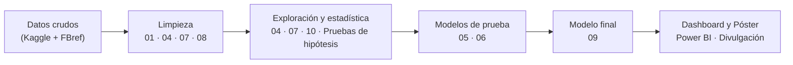
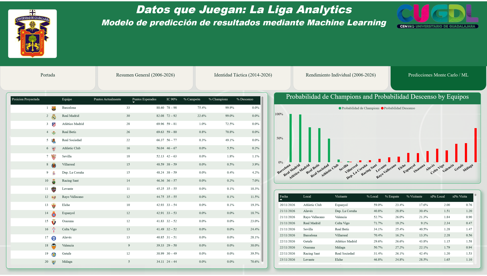
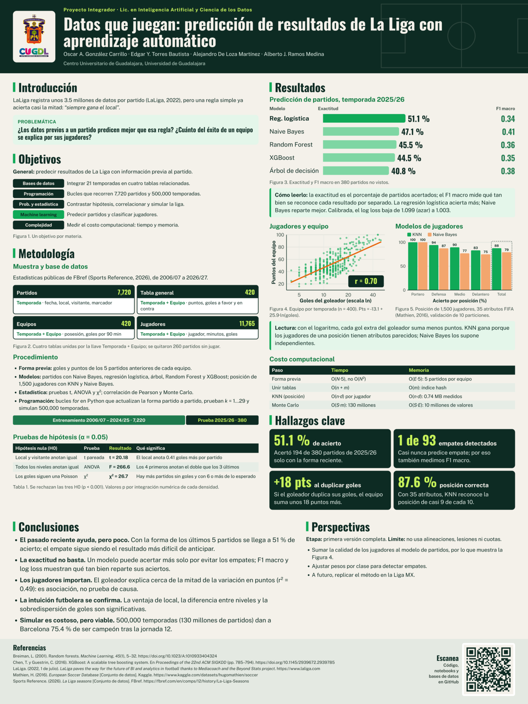

# ⚽ Proyecto Integrador: Analítica y Predicción de Resultados en La Liga

> **¿Es posible predecir el resultado de un partido (Victoria, Empate, Derrota) con la información disponible antes de que se juegue? Y con esas probabilidades, ¿cómo podría terminar la temporada?**

Proyecto de ciencia de datos sobre la liga española que integra ingeniería de datos en Python, inferencia estadística, Machine Learning, simulación Monte Carlo, un dashboard de inteligencia de negocios en Power BI y un póster académico.

Este proyecto tiene el objetivo de demostrar que la ciencia de datos en el CUGDL no solo debe limitarse a conceptos de IA, sino que puede ser mucho más grande y variado que eso.

---

## 🧭 ¿Por dónde empiezo?

| Si quieres... | Ve a |
| --- | --- |
| Ver el **Dashboard interactivo** (función, capturas y documentos usados) | [`dashboard/README.md`](dashboard/README.md) · [`Dashboard_LaLiga.pbix`](dashboard/Dashboard_LaLiga.pbix) · [`PDF`](dashboard/Dashboard_LaLiga.pdf) |
| Consultar el **Póster académico** del proyecto | [`poster/README.md`](poster/README.md) · [`Poster_Datos_que_Juegan.pdf`](poster/Poster_Datos_que_Juegan.pdf) |
| Ver el **resultado final** (modelo + proyección de la temporada) | [`notebooks/09_ML_Final.ipynb`](notebooks/09_ML_Final.ipynb) |
| Entender **qué hace cada notebook** y en qué orden leerlos | [`notebooks/README.md`](notebooks/README.md) |
| Saber **qué datos hay** y de dónde salen | [`data/README.md`](data/README.md) |
| Consultar las **columnas de FBref** | [`data/fbref/README.md`](data/fbref/README.md) |
| Ver la **limpieza de la European Soccer Database** | [`data/processed/clean/README.md`](data/processed/clean/README.md) |
| Revisar las **pruebas de hipótesis** | [`notebook_probabilidad/README.md`](notebook_probabilidad/README.md) |

### Ruta de lectura recomendada



---

## 📂 Estructura del repositorio

```
proyecto-integrador-laliga/
├── dashboard/                   → Dashboard en Power BI (.pbix, .pdf), capturas, dimensiones y guía
├── poster/                      → Póster académico (.pdf, .png) y síntesis de hallazgos
├── data/                        → Todos los datos del proyecto (ver data/README.md)
│   ├── raw/                     → European Soccer Database original (SQLite comprimido)
│   ├── processed/               → Tablas de La Liga extraídas de la European Soccer Database
│   │   ├── clean/               → Versiones limpias listas para modelar
│   │   └── analisis de datos/   → Resúmenes de goles en Excel (insumo inicial para Power BI)
│   └── fbref/                   → Datos de FBref por temporada (2006/07 – 2026/27)
│       └── processed/           → Consolidado histórico de FBref
│           └── clean/           → Tablas limpias y predicciones ML listas para Power BI
├── notebooks/                   → Flujo principal: limpieza → EDA → modelado (ver notebooks/README.md)
├── notebook_probabilidad/       → Pruebas de hipótesis e inferencia estadística
└── README.md                    → Este archivo
```

---

## 🗄️ Fuentes de datos

| Fuente | Periodo | Qué aporta | Dónde se usa |
| --- | --- | --- | --- |
| [European Soccer Database](https://www.kaggle.com/datasets/hugomathien/soccer) (Kaggle) | 2008/09 – 2015/16 | Partidos, alineaciones, atributos FIFA de jugadores y equipos, cuotas de casas de apuestas. | Notebooks 01 a 07 y pruebas de hipótesis. |
| [FBref](https://fbref.com/) | 2006/07 – 2026/27 | Resultados, clasificación y estadísticas de equipos y jugadores, incluida la temporada en curso. | Notebooks 07, 08, 09, 10 y Dashboard Power BI. |

**¿Por qué dos fuentes?** La European Soccer Database permitió construir el primer predictor (notebook 06), pero termina en 2016. Para tener más temporadas y poder proyectar la temporada actual, el modelo final y el dashboard se construyeron con FBref. Más detalle en [`data/README.md`](data/README.md).

---

## 🤖 Resultado del modelo final

El [notebook 09](notebooks/09_ML_Final.ipynb) usa solo información **previa a cada partido** (forma de los últimos 5 partidos) y se valida con una temporada completa que el modelo no vio (2025/26).

| Modelo (calibrado) | Accuracy | Log loss | Brier |
| --- | --- | --- | --- |
| **Regresión Logística** ✅ | **0.505** | **1.003** | **0.200** |
| XGBoost | 0.500 | 1.010 | 0.201 |
| Random Forest | 0.495 | 1.014 | 0.202 |

Con el modelo ganador se simularon los partidos pendientes de la temporada 2026/27 **500,000 veces** para estimar la probabilidad de cada equipo de ser campeón, clasificar a Champions o descender.

**Hallazgos principales:** la ventaja de jugar en casa domina, los empates son casi impredecibles y un modelo simple y bien calibrado superó a los modelos complejos.

---

## 📊 Dashboard en Power BI

El archivo [`dashboard/Dashboard_LaLiga.pbix`](dashboard/Dashboard_LaLiga.pbix) ([versión PDF](dashboard/Dashboard_LaLiga.pdf)) conecta las tablas limpias históricas de FBref (`2006–2026`) con las predicciones de Machine Learning y simulación Monte Carlo (`2026/27`) mediante un modelo en estrella de 8 tablas (`2` dimensiones en `dashboard/` + `6` tablas de hechos en `data/fbref/processed/clean/`).

| Página | ¿Qué explica? |
| --- | --- |
| **1. Portada** | Alcance global (`7,720` partidos, `41` clubes, `21` temporadas) y navegación inicial. |
| **2. Resumen General (2006-2026)** | Ventaja histórica de localía, KPIs globales, tabla clasificatoria con escudos y Top 10 puntos Local vs. Visitante. |
| **3. Identidad Táctica (2014-2026)** | Relación entre posesión real (`≥ 2014`), goles/90 min, balance ataque–defensa y generación ofensiva (goles sin penal vs. asistencias). |
| **4. Rendimiento Individual (2006-2026)** | Top 25 de goleadores/asistidores, dispersión de minutos vs. impacto ofensivo (`G+A / 90`) y tabla estadística filtrable por posición. |
| **5. Predicciones Monte Carlo / ML** | Tabla final proyectada (`xPts`, `IC 90%`), probabilidades de Champions vs. Descenso y pronóstico de los `260` partidos pendientes. |



📄 Documentación completa, capturas de las 5 páginas y diccionario de documentos utilizados en [`dashboard/README.md`](dashboard/README.md).

---

## 🖼️ Póster académico

El póster resume la integración del proyecto entre cinco asignaturas (*Bases de datos, Programación, Probabilidad y estadística, Machine Learning y Complejidad*), el contraste de hipótesis (`p < 0.001`), la relación entre goles del goleador y puntos del equipo (`r = 0.70`) y los resultados del modelado predictivo.



📄 Ver detalle de hallazgos y descargar PDF en [`poster/README.md`](poster/README.md).

---

## 📌 Fases de desarrollo

- [x] **Fase 1:** Extracción, limpieza y normalización de las bases de datos (European Soccer Database + FBref).
- [x] **Fase 2:** Análisis exploratorio, correlación de variables y pruebas de hipótesis.
- [x] **Fase 3:** Modelado de Machine Learning y simulación Monte Carlo.
- [x] **Fase 4:** Dashboard interactivo en Power BI ([`dashboard/Dashboard_LaLiga.pbix`](dashboard/Dashboard_LaLiga.pbix)).
- [ ] **Fase 5:** Reporte técnico (desarrollo matemático, métricas y evaluaciones).
- [x] **Fase 6:** Póster académico ([`poster/Poster_Datos_que_Juegan.pdf`](poster/Poster_Datos_que_Juegan.pdf)).

---

## ▶️ Cómo ejecutar el proyecto

1. **Clona el repositorio**
   ```bash
   git clone https://github.com/GzzAlejandro/proyecto-integrador-laliga.git
   cd proyecto-integrador-laliga
   ```
2. **Instala las dependencias** (Python 3.11 recomendado)
   ```bash
   pip install pandas numpy scipy scikit-learn xgboost matplotlib seaborn openpyxl jupyter
   ```
3. **Abre los notebooks desde la carpeta `notebooks/`**, porque usan rutas relativas (`../data/...`).

> [!IMPORTANT]
> Los archivos limpios de FBref (`data/fbref/processed/clean/*`), las predicciones (`Predicciones_*.csv`) y las dimensiones del tablero (`dashboard/*.csv`) **ya están en GitHub** listos para el dashboard y los notebooks 09 y 10.
>
> En cambio, `.gitignore` excluye los CSV crudos de Kaggle: si quieres re-ejecutar desde el notebook 01, descomprime `data/raw/database.sqlite.zip` y exporta sus tablas a CSV en `data/raw/`. El orden completo está en [`notebooks/README.md`](notebooks/README.md).

---

## 🛠️ Tecnologías

Python · Pandas · NumPy · SciPy · scikit-learn · XGBoost · Matplotlib · Seaborn · Jupyter · Google Colab · Power BI

## 👥 Equipo de trabajo

- **Oscar Alejandro González Carrillo** - [@GzzAlejandro](https://github.com/GzzAlejandro)
- **Edgar Yamil Torres Bautista** - [@Yami-Torres](https://github.com/Yami-Torres)
- **De Loza Martinez Alejandro** - [@Alex-De-Loza](https://github.com/Alex-De-Loza)
- **Alberto Jared Ramos Medina** - [@albertoramos7282-eng](https://github.com/albertoramos7282-eng)
