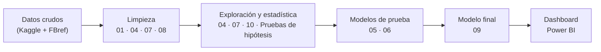

# ⚽ Proyecto Integrador: Analítica y Predicción de Resultados en La Liga

> **¿Es posible predecir el resultado de un partido (Victoria, Empate, Derrota) con la información disponible antes de que se juegue? Y con esas probabilidades, ¿cómo podría terminar la temporada?**

Proyecto de ciencia de datos sobre la liga española que integra ingeniería de datos en Python, inferencia estadística, Machine Learning, simulación Monte Carlo y un dashboard de inteligencia de negocios en Power BI.

Este proyecto tiene el objetivo de demostrar que la ciencia de datos en el CUGDL no solo debe limitarse a conceptos de IA, sino que puede ser mucho más grande y variado que eso.

---

## 🧭 ¿Por dónde empiezo?

| Si quieres... | Ve a |
| --- | --- |
| Ver el **resultado final** (modelo + proyección de la temporada) | [`notebooks/09_ML_Final.ipynb`](notebooks/09_ML_Final.ipynb) |
| Entender **qué hace cada notebook** y en qué orden leerlos | [`notebooks/README.md`](notebooks/README.md) |
| Saber **qué datos hay** y de dónde salen | [`data/README.md`](data/README.md) |
| Consultar las **columnas de FBref** | [`data/fbref/README.md`](data/fbref/README.md) |
| Ver la **limpieza de la European Soccer Database** | [`data/processed/clean/README.md`](data/processed/clean/README.md) |
| Revisar las **pruebas de hipótesis** | [`notebook_probabilidad/README.md`](notebook_probabilidad/README.md) |

### Ruta de lectura recomendada



---

## 📂 Estructura del repositorio

```
proyecto-integrador-laliga/
├── data/                        → Todos los datos del proyecto (ver data/README.md)
│   ├── raw/                     → European Soccer Database original (SQLite comprimido)
│   ├── processed/               → Tablas de La Liga extraídas de la European Soccer Database
│   │   ├── clean/               → Versiones limpias listas para modelar
│   │   └── analisis de datos/   → Resúmenes de goles en Excel (insumo para Power BI)
│   └── fbref/                   → Datos de FBref por temporada (2006/07 – 2026/27)
│       └── processed/           → Consolidado histórico de FBref
├── notebooks/                   → Flujo principal: limpieza → EDA → modelado (ver notebooks/README.md)
├── notebook_probabilidad/       → Pruebas de hipótesis e inferencia estadística
└── README.md                    → Este archivo
```

---

## 🗄️ Fuentes de datos

| Fuente | Periodo | Qué aporta | Dónde se usa |
| --- | --- | --- | --- |
| [European Soccer Database](https://www.kaggle.com/datasets/hugomathien/soccer) (Kaggle) | 2008/09 – 2015/16 | Partidos, alineaciones, atributos FIFA de jugadores y equipos, cuotas de casas de apuestas. | Notebooks 01 a 07 y pruebas de hipótesis. |
| [FBref](https://fbref.com/) | 2006/07 – 2026/27 | Resultados, clasificación y estadísticas de equipos y jugadores, incluida la temporada en curso. | Notebooks 07, 08, 09 y 10. |

**¿Por qué dos fuentes?** La European Soccer Database permitió construir el primer predictor (notebook 06), pero termina en 2016. Para tener más temporadas y poder proyectar la temporada actual, el modelo final se construyó con FBref. Más detalle en [`data/README.md`](data/README.md).

---

## 🤖 Resultado del modelo final

El [notebook 09](notebooks/09_ML_Final.ipynb) usa solo información **previa a cada partido** (forma de los últimos 5 partidos) y se valida con una temporada completa que el modelo no vio (2025/26).

| Modelo (calibrado) | Accuracy | Log loss | Brier |
| --- | --- | --- | --- |
| **Regresión Logística** ✅ | **0.505** | **1.003** | **0.200** |
| XGBoost | 0.500 | 1.010 | 0.201 |
| Random Forest | 0.495 | 1.014 | 0.202 |

Con el modelo ganador se simularon los partidos pendientes de la temporada 2026/27 **500,000 veces** para estimar la probabilidad de cada equipo de ser campeón, clasificar a Champions o descender.

**Hallazgos principales:** la ventaja de jugar en casa domina, los empates son casi impredecibles y un modelo simple y bien calibrado superó a los modelos complejos.

---

## 📌 Fases de desarrollo

- [x] **Fase 1:** Extracción, limpieza y normalización de las bases de datos (European Soccer Database + FBref).
- [x] **Fase 2:** Análisis exploratorio, correlación de variables y pruebas de hipótesis.
- [x] **Fase 3:** Modelado de Machine Learning y simulación Monte Carlo.
- [ ] **Fase 4:** Dashboard interactivo en Power BI — 🔄 *en proceso.*
- [ ] **Fase 5:** Reporte técnico (desarrollo matemático, métricas y evaluaciones).
- [ ] **Fase 6:** Póster académico (metodología y perspectivas futuras).

---

## ▶️ Cómo ejecutar el proyecto

1. **Clona el repositorio**
   ```bash
   git clone https://github.com/GzzAlejandro/proyecto-integrador-laliga.git
   cd proyecto-integrador-laliga
   ```
2. **Instala las dependencias** (Python 3.11 recomendado)
   ```bash
   pip install pandas numpy scipy scikit-learn xgboost matplotlib seaborn openpyxl jupyter
   ```
3. **Abre los notebooks desde la carpeta `notebooks/`**, porque usan rutas relativas (`../data/...`).

> [!IMPORTANT]
> El archivo `.gitignore` excluye la mayoría de los `.csv`, así que algunos archivos intermedios **no están en GitHub** y se generan al ejecutar los notebooks:
> - **European Soccer Database:** descomprime `data/raw/database.sqlite.zip` y exporta sus tablas a CSV en `data/raw/` antes de correr el notebook 01.
> - **FBref:** ejecuta el notebook `08_EDA_limpieza` para generar `data/fbref/processed/clean/*_historico_limpio.csv`, que necesitan los notebooks 09 y 10.
>
> El orden completo está en [`notebooks/README.md`](notebooks/README.md).

---

## 🛠️ Tecnologías

Python · Pandas · NumPy · SciPy · scikit-learn · XGBoost · Matplotlib · Seaborn · Jupyter · Google Colab · Power BI

## 👥 Equipo de trabajo

- **Oscar Alejandro González Carrillo** - [@GzzAlejandro](https://github.com/GzzAlejandro)
- **Edgar Yamil Torres Bautista** - [@Yami-Torres](https://github.com/Yami-Torres)
- **De Loza Martinez Alejandro** - [@Alex-De-Loza](https://github.com/Alex-De-Loza)
- **Alberto Jared Ramos Medina** - [@albertoramos7282-eng](https://github.com/albertoramos7282-eng)
