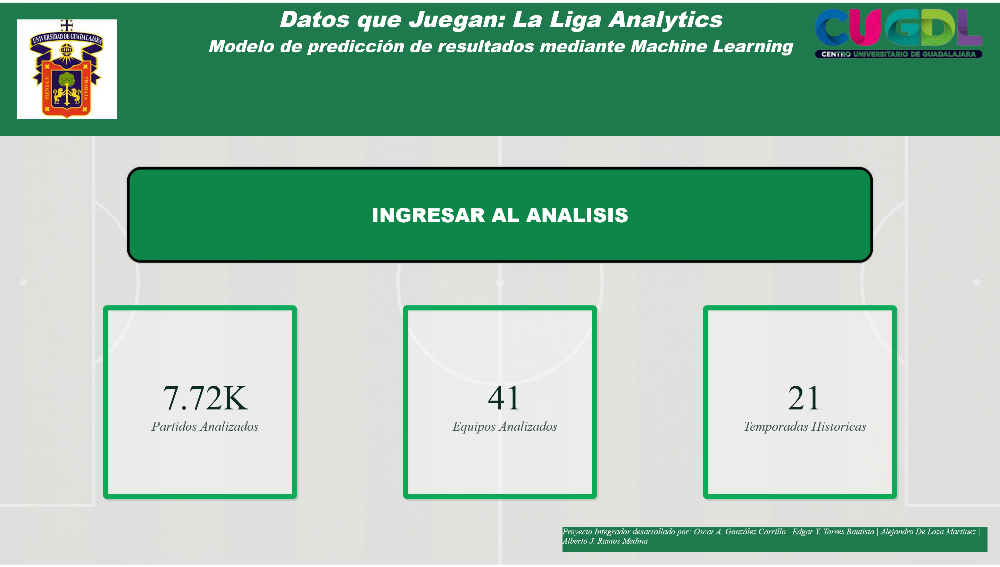
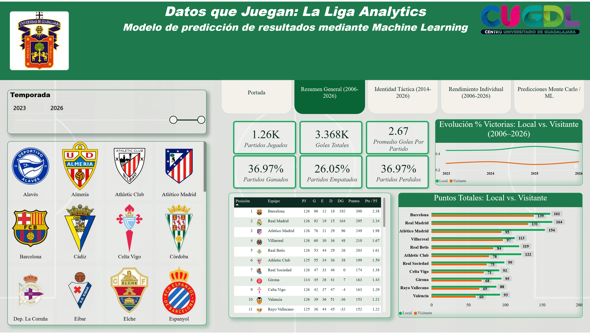
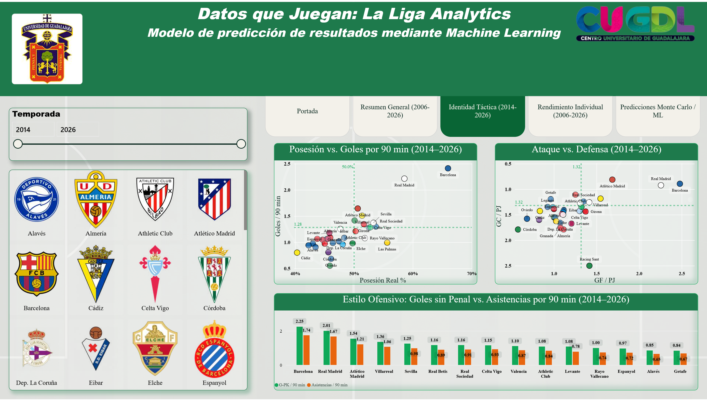
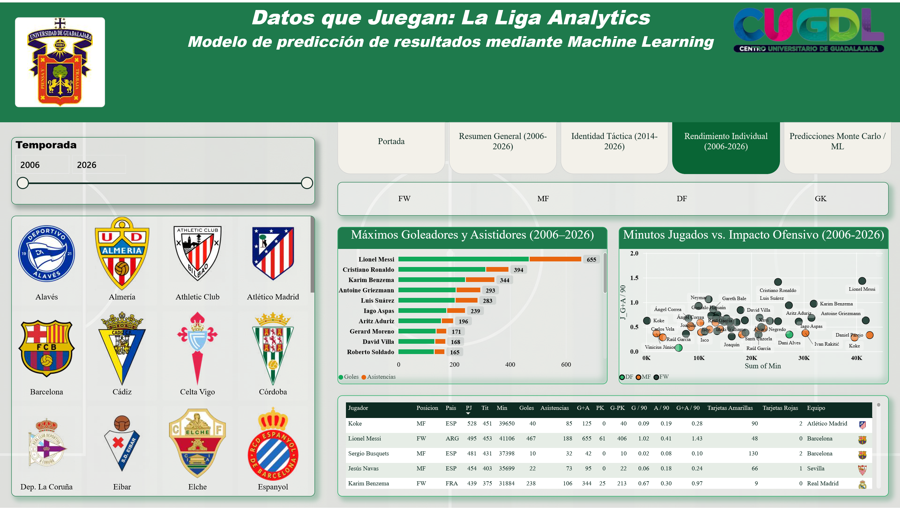
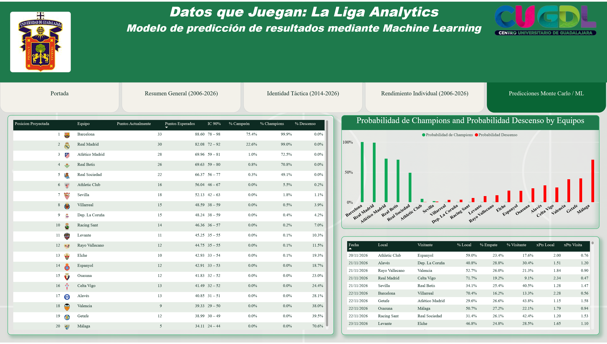
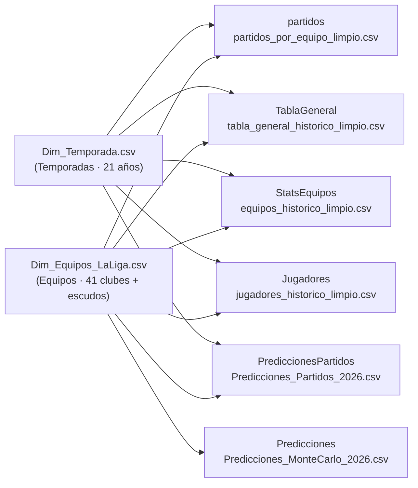

# 📊 Dashboard: Datos que Juegan — La Liga Analytics (2006–2026)

> **¿Cómo evolucionaron 21 temporadas de La Liga y qué proyecta el modelo de Machine Learning para el cierre de la campaña 2026/27?**

Tablero interactivo en Power BI ([`Dashboard_LaLiga.pbix`](Dashboard_LaLiga.pbix) · versión exportada en [`Dashboard_LaLiga.pdf`](Dashboard_LaLiga.pdf)) que integra la base histórica consolidada de **FBref (`2006/07` – `2026/27`)** con las probabilidades calibradas de **Regresión Logística** y **`500,000` simulaciones Monte Carlo** generadas en [`09_ML_Final.ipynb`](../notebooks/09_ML_Final.ipynb).

---

## 🎯 ¿Para qué sirve?

El dashboard traduce los datos limpios y las predicciones del proyecto en una herramienta visual interactiva (`1920 × 1080`) para responder cuatro preguntas concretas sin escribir código:

1. **¿Qué peso tiene la localía en La Liga?** Permite medir por temporada y por club la brecha entre victorias, goles y puntos obtenidos como local frente a visitante.
2. **¿La posesión explica el rendimiento?** Cruza posesión real, producción ofensiva sin penales, asistencias y solidez defensiva desde `2014/15` en adelante.
3. **¿Qué futbolistas producen más por volumen y por eficiencia?** Combina goles y asistencias totales contra impacto ofensivo por cada 90 minutos, filtrable por posición y club.
4. **¿Cómo puede terminar la temporada `2026/27`?** Traduce las probabilidades partido a partido del modelo de Machine Learning en tabla final proyectada, intervalos de confianza (`IC 90%`) y riesgos de título, Champions o descenso.

---

## 🧭 Recorrido por las 5 páginas

| # | Página | Qué hace | Qué explica | Alcance / filtros |
| --- | --- | --- | --- | --- |
| 1 | **`Portada`** | Presenta el proyecto (`UDG / CUGDL`) y da acceso directo al análisis. | Resume la escala del estudio: `7.72K` (`7,720`) partidos, `41` equipos y `21` temporadas. | Vista global fija (`2006–2026`). |
| 2 | **`Resumen General (2006-2026)`** | Explora el desempeño histórico por temporada y por club. | Ventaja de localía en el tiempo, KPIs globales, tabla general con escudos y Top 10 de puntos Local vs. Visitante. | Slicers de `Temporada` y `Equipo`. |
| 3 | **`Identidad Táctica (2014-2026)`** | Compara estilos colectivos de juego entre clubes. | Posesión real % vs. goles/90 min, balance ataque–defensa (`GF/PJ` vs. `GC/PJ`) y goles sin penal vs. asistencias/90 min (Top 15). | Filtro de página bloqueado (`Tiene_Posesion_Real = "Sí"`) + slicers de `Temporada` (`2014–2026`) y `Equipo`. |
| 4 | **`Rendimiento Individual (2006-2026)`** | Evalúa la producción de jugadores por temporada, equipo y posición. | Top 25 de goleadores/asistidores, dispersión `Minutos` vs. `G+A / 90` (Top 40) y ficha estadística individual completa. | Slicers de `Temporada`, `Equipo` y `Pos_Principal` (`FW`, `MF`, `DF`, `GK`). |
| 5 | **`Predicciones Monte Carlo / ML`** | Expone las salidas predictivas para los partidos restantes de `2026/27`. | Tabla final proyectada (`xPts`, `IC 90%`, `% Campeón`, `% Champions`, `% Descenso`), contraste Champions vs. Descenso y calendario futuro ordenado por fecha. | Escenario `2026/27` (`20` equipos y `260` partidos pendientes). |

### Vistas del Dashboard

#### 1. Portada

Contexto institucional (`Datos que Juegan: La Liga Analytics`), botón de entrada (`INGRESAR AL ANALISIS`) y tres tarjetas de alcance histórico (`7.72K` partidos, `41` clubes, `21` temporadas).

#### 2. Resumen General (2006-2026)

KPIs agregados (`Partidos Jugados`, `Goles Totales`, `Promedio Goles Por Partido`, `% Ganados`, `% Empatados`, `% Perdidos`), evolución anual del `% Victorias: Local vs. Visitante`, tabla clasificatoria con escudos y Top 10 de `Puntos Totales: Local vs. Visitante`.

#### 3. Identidad Táctica (2014-2026)

Restringida automáticamente a `2014–2026` para evitar el marcador neutro `50.0%` de posesión de años previos: cruza `Posesión Real %` vs. `Goles / 90 min`, `Ataque vs. Defensa` (`GF / PJ` vs. `GC / PJ`) y `Estilo Ofensivo` (`G-PK / 90 min` vs. `Asistencias / 90 min`).

#### 4. Rendimiento Individual (2006-2026)

Filtrado por `Temporada`, `Equipo` y `Pos_Principal` (`FW`, `MF`, `DF`, `GK`, excluyendo `'Desconocido'`): barras de `Máximos Goleadores y Asistidores`, dispersión `Minutos Jugados vs. Impacto Ofensivo` (`Sum of Min` vs. `J_G+A / 90`) y tabla detallada por futbolista.

#### 5. Predicciones Monte Carlo / ML

Tabla clasificatoria proyectada con `500,000` simulaciones Monte Carlo, comparativa gráfica de `Probabilidad de Champions` vs. `Probabilidad Descenso` y probabilidades calibradas (`% Local`, `% Empate`, `% Visitante`, `xPts Local`, `xPts Visita`) para los `260` partidos por disputarse.

---

## 🗄️ Documentos y tablas utilizados

El modelo relacional de Power BI sigue un **esquema en estrella** alimentado por **2 dimensiones** en esta carpeta y **6 tablas de hechos / predicciones** en [`data/fbref/processed/clean/`](../data/fbref/processed/clean/):

### Dimensiones (`dashboard/`)

| Archivo | Tabla en Power BI | Registros | Columnas | Para qué se usa |
| --- | --- | --- | --- | --- |
| [`Dim_Temporada.csv`](Dim_Temporada.csv) | `Temporadas` | `21` | `Temporada`, `Etiqueta_Temporada`, `Es_Temporada_Actual`, `Tiene_Posesion_Real` | Eje cronológico (`2006`–`2026`) y filtro automático de posesión real (`2014`–`2026`). |
| [`Dim_Equipos_LaLiga.csv`](Dim_Equipos_LaLiga.csv) | `Equipos` | `41` | `Equipo_ID`, `Squad`, `imagen`, `color_principal`, `color_secundario` | Catálogo unificado de clubes, URLs PNG de escudos oficiales y paleta de equipo. |

### Tablas de hechos y predicciones (`data/fbref/processed/clean/`)

| Archivo | Tabla en Power BI | Registros | Campos principales | Notebook de origen |
| --- | --- | --- | --- | --- |
| [`partidos_por_equipo_limpio.csv`](../data/fbref/processed/clean/partidos_por_equipo_limpio.csv) | `partidos` | `15,440` (`7,720` partidos × 2) | `Partido_ID`, `Temporada`, `Date`, `Squad`, `Rival`, `Condicion`, `GF`, `GC`, `Dif_Goles`, `Pts`, `Resultado` | [`08_EDA_limpieza`](../notebooks/08_EDA_limpieza.ipynb) |
| [`tabla_general_historico_limpio.csv`](../data/fbref/processed/clean/tabla_general_historico_limpio.csv) | `TablaGeneral` | `420` | `Temporada`, `Rk`, `Squad`, `MP`, `W`, `D`, `L`, `GF`, `GA`, `GD`, `Pts`, `Pts/MP` | [`08_EDA_limpieza`](../notebooks/08_EDA_limpieza.ipynb) |
| [`equipos_historico_limpio.csv`](../data/fbref/processed/clean/equipos_historico_limpio.csv) | `StatsEquipos` | `420` | `Temporada`, `Squad`, `# Pl`, `Age`, `Poss`, `MP`, `Starts`, `Min`, `90s`, `Gls`, `Ast`, `G+A`, `G-PK`, `PK`, `PKatt`, `CrdY`, `CrdR`, `*_per90` | [`08_EDA_limpieza`](../notebooks/08_EDA_limpieza.ipynb) |
| [`jugadores_historico_limpio.csv`](../data/fbref/processed/clean/jugadores_historico_limpio.csv) | `Jugadores` | `11,765` | `Temporada`, `Rk`, `Player`, `Nation`, `Pos`, `Pos_Principal`, `Squad`, `Age`, `Born`, `MP`, `Starts`, `Min`, `90s`, `Gls`, `Ast`, `G+A`, `G-PK`, `PK`, `PKatt`, `CrdY`, `CrdR`, `Gls.1`..`G+A-PK` | [`08_EDA_limpieza`](../notebooks/08_EDA_limpieza.ipynb) |
| [`Predicciones_MonteCarlo_2026.csv`](../data/fbref/processed/clean/Predicciones_MonteCarlo_2026.csv) | `Predicciones` | `20` | `Posicion_Proyectada`, `Squad`, `Pts_Actuales`, `xPts_Promedio_Final`, `IC90_Pts_5`, `IC90_Pts_95`, `Prob_Campeon_%`, `Prob_Champions_%`, `Prob_Descenso_%` | [`09_ML_Final`](../notebooks/09_ML_Final.ipynb) |
| [`Predicciones_Partidos_2026.csv`](../data/fbref/processed/clean/Predicciones_Partidos_2026.csv) | `PrediccionesPartidos` | `260` | `Temporada`, `Date`, `Home`, `Away`, `P_Derrota`, `P_Empate`, `P_Victoria`, `xPts_Local`, `xPts_Visita` | [`09_ML_Final`](../notebooks/09_ML_Final.ipynb) |

> [!TIP]
> Si abres [`Dashboard_LaLiga.pbix`](Dashboard_LaLiga.pbix) en otro equipo y deseas refrescar datos desde los CSV, actualiza la ruta raíz en **Transformar datos → Configuración de origen de datos** apuntando a tu copia local de este repositorio. Si solo quieres revisar el diseño sin Power BI Desktop, consulta [`Dashboard_LaLiga.pdf`](Dashboard_LaLiga.pdf).
