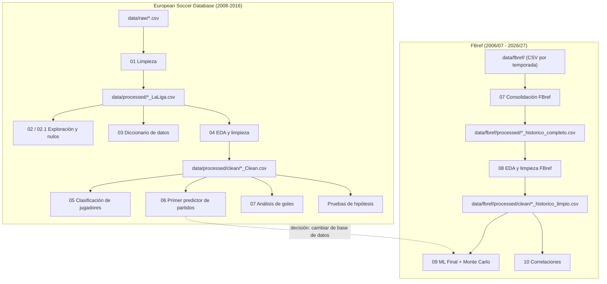

# 📓 Notebooks

Aquí está todo el flujo de trabajo del proyecto, desde la limpieza de los datos hasta el modelo final. Los números indican el orden aproximado en que se desarrollaron.

> [!TIP]
> Si solo tienes tiempo para uno, abre **[`09_ML_Final.ipynb`](09_ML_Final.ipynb)**: tiene el modelo final, la proyección de la temporada y las conclusiones.

## 🗺️ Mapa del flujo

## 📋 Detalle de cada notebook

### Parte 1 — European Soccer Database

| Notebook | ¿Qué hace? | Lee | Genera |
| --- | --- | --- | --- |
| [`01_limpieza_bases_de_datos`](01_limpieza_bases_de_datos.ipynb) | Filtra la base europea a **La Liga** y prepara las 5 tablas (partidos, equipos, jugadores y sus atributos). | `data/raw/*.csv` | `data/processed/*_LaLiga.csv` |
| [`02_Bases_de_datos_La_liga`](02_Bases_de_datos_La_liga.ipynb) | Primera revisión de las tablas de La Liga. | `*_LaLiga.csv` | — |
| [`02.1Diccionario_valores_nulos...`](02.1Diccionario_valores_nulos_Bases_de_datos_La_liga.ipynb) | Análisis detallado de valores nulos por tabla. | `*_LaLiga.csv` | — |
| [`03_validacion_y_diccionario_de_datos`](03_validacion_y_diccionario_de_datos.ipynb) | Crea un diccionario con cada columna: tipo, nulos y un ejemplo. | `*_LaLiga.csv` | `data/processed/Diccionario_Global.csv` |
| [`04_ExploracionDeDatos`](04_ExploracionDeDatos.ipynb) | EDA y limpieza: imputación de nulos, conversión de unidades y extracción de eventos del XML de partidos. | `*_LaLiga.csv` | `data/processed/clean/*_Clean.csv` |
| [`05_clasificacion_de_jugadores`](05_clasificacion_de_jugadores.ipynb) | Predice la **posición** de un jugador (GK, DEF, MID, FWD) con sus atributos FIFA usando **KNN**; lo compara con Naive Bayes y K-Means, y estima su rating con regresión. | `*_Clean.csv` | — |
| [`06_predictor_de_partidos`](06_predictor_de_partidos.ipynb) | **Primer predictor de partidos**: identidad del equipo, fuerza de plantilla, forma reciente y táctica; comparación contra casas de apuestas y simulación de la temporada 2015/16. Concluye que hace falta una base de datos más reciente. | `*_Clean.csv` | `data/processed/Evaluacion_Apuestas_Binario.csv` |
| [`07_Analisis_de_datos_la_liga_clean`](07_Analisis_de_datos_la_liga_clean.ipynb) | Análisis de goles en varios niveles; exporta el resumen a Excel para Power BI. | `*_Clean.csv` | `data/processed/analisis de datos/*.xlsx` |

### Parte 2 — FBref y modelo final

| Notebook | ¿Qué hace? | Lee | Genera |
| --- | --- | --- | --- |
| [`07_exploracion_base_de_datos`](07_exploracion_base_de_datos.ipynb) | **Consolida** los CSV de FBref de cada temporada en una sola tabla histórica por tipo (partidos, equipos, jugadores, tabla general) y corrige la codificación UTF-8 para Power BI. | `data/fbref/<carpeta>/*.csv` | `data/fbref/processed/*_historico_completo.csv` |
| [`08_EDA_limpieza`](08_EDA_limpieza.ipynb) | Limpieza y EDA de FBref: tipos de datos, marcador separado en goles y puntos, nombres de columnas. | `*_historico_completo.csv` | `data/fbref/processed/clean/*_historico_limpio.csv` |
| [`09_ML_Final`](09_ML_Final.ipynb) | ⭐ **Modelo final.** Variables de forma reciente sin fuga de información, comparación de 5 modelos, calibración de probabilidades y **simulación Monte Carlo** de la temporada 2026/27. | `*_historico_limpio.csv` | — |
| [`10_Correlaciones`](10_Correlaciones.ipynb) | Mapas de calor de Pearson y ranking de las relaciones más fuertes entre las estadísticas de FBref. Es descriptivo: no entrena modelos. | `*_historico_limpio.csv` | — |

## ⚙️ Antes de ejecutar

- **Abre Jupyter desde esta carpeta** (`notebooks/`): la mayoría de los notebooks usa rutas relativas como `../data/...`.
- **Algunos notebooks se hicieron en Google Colab o en la computadora de un integrante** y tienen rutas fijas que hay que cambiar por la ruta relativa (`../data/processed/...`):
  - `02_Bases_de_datos_La_liga` y `02.1Diccionario_valores_nulos...` → `/content/drive/MyDrive/...`
  - `07_Analisis_de_datos_la_liga_clean` → `C:\Users\edgar\...`
- **Archivos que no están en GitHub:** el `.gitignore` excluye la mayoría de los `.csv`. Para reproducir todo:
  1. Descomprime `data/raw/database.sqlite.zip` y exporta sus tablas a CSV en `data/raw/` (necesario para el notebook 01).
  2. Ejecuta `07_exploracion_base_de_datos` y después `08_EDA_limpieza` para generar los datos de FBref que usan los notebooks 09 y 10.
- **La simulación del notebook 09 es pesada** (500,000 simulaciones). Para pruebas rápidas puedes bajar `n_simulaciones`.
