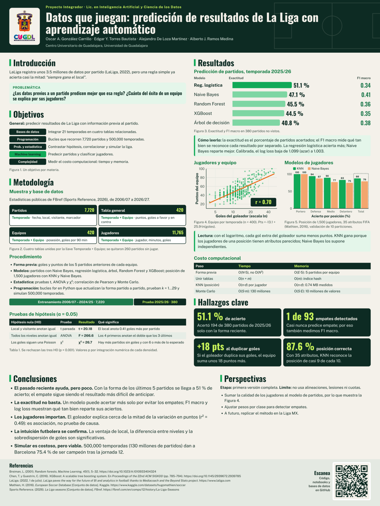

# 🖼️ Póster académico: Datos que juegan

> **¿Los datos previos a un partido predicen mejor que "siempre gana el local"? ¿Cuánto del éxito de un equipo se explica por sus jugadores?**

Póster académico del proyecto integrador (*Lic. en Inteligencia Artificial y Ciencia de los Datos · CUGDL, Universidad de Guadalajara*) que sintetiza la problemática, metodología, pruebas estadísticas, evaluación de modelos, complejidad computacional y conclusiones del estudio.

📄 Versión descargable en PDF: [`Poster_Datos_que_Juegan.pdf`](Poster_Datos_que_Juegan.pdf)

---

---

## 🎯 Objetivos por materia

| Materia | Aporte al proyecto |
| --- | --- |
| **Bases de datos** | Integración de 21 temporadas de FBref en cuatro tablas relacionadas por la llave `Temporada + Equipo`. |
| **Programación** | Bucles en Python que recorren `7,720` partidos partido a partido y simulan `500,000` temporadas. |
| **Prob. y estadística** | Pruebas de hipótesis (`t` pareada, ANOVA, `χ²`), correlación logarítmica (`r = 0.70`) y simulación Monte Carlo. |
| **Machine learning** | Predicción de resultados (5 modelos) y clasificación de posición de `1,500` jugadores (`KNN` vs. `Naive Bayes`). |
| **Complejidad** | Medición de costo temporal y espacial (`O(N·5)` en forma previa, `O(S·m)` en Monte Carlo). |

## 💡 Hallazgos clave reportados

| Resultado | Qué significa |
| --- | --- |
| **`51.1%` de acierto** | La Regresión Logística acertó `194` de `380` partidos no vistos (`2025/26`) solo con forma previa; calibrada bajó el log loss de `1.099` a `1.003`. |
| **`1` de `93` empates detectados** | El empate es el resultado más difícil de predecir; por ello también se evalúa **F1 macro** (`0.34` en Reg. logística, `0.41` en Naive Bayes). |
| **`+18 pts` al duplicar goles** | Los goles del máximo anotador explican cerca de la mitad de la variación en puntos (`r = 0.70`, `r² = 0.49`, `n = 400`). |
| **`87.6%` posición correcta** | Con `35` atributos FIFA (European Soccer Database), **KNN** supera a Naive Bayes (`79%`) al conservar correlaciones entre atributos. |
| **3 hipótesis `H0` rechazadas** | Se confirma ventaja de local (`t = 20.18`), diferencia entre niveles (`F = 266.6`) y sobredispersión respecto a Poisson (`χ² = 26.7`), con `p < 0.001`. |
